  
  

  
  
  
  
  
  
  
  

  
  

---

### ⚙️ C++

| Project | | Years |
|---|---|---|
| 🎮 [**Tyra**](https://github.com/h4570/tyra) | PlayStation 2 game engine | 2020–2022 |
| 🏖️ [**OpenBeach**](https://github.com/h4570/openbeach) | Open reimplementation of *Beach Life* for the browser, Windows and Linux | 2026– |
| 📦 [libpacket2 in PS2SDK](https://github.com/ps2dev/ps2sdk/commit/f870e2d4127d3b06fe6acd19025aba9eaa254edc) | Vector Unit support (contribution) in the PS2SDK | 2020 |
| 🚗 [QNX game for Audi](https://github.com/h4570/qnx-audi) | Game running on QNX | 2021–2022 |
| 🕹️ [GTA:SA Trainer](https://github.com/h4570/gtasa-internal-trainer) | Internal trainer for GTA: San Andreas | 2019 |

### 🟣 C# / .NET

| Project | | Years |
|---|---|---|
| [ingoodhands](https://github.com/PJATK-SPK/ingoodhands) | C# + Angular | 2022–2023 |
| [Armnas](https://github.com/h4570/armnas) | C# + Angular | 2021–2022 |
| [SPK](https://github.com/PJATK-SPK/spk) | | 2021–2023 |
| [Design patterns](https://github.com/h4570/design-patterns) | | 2020 |
| [Crackmes](https://github.com/h4570/crackmes/tree/main) | | 2023 |

### 🦀 Rust

| Project | | Years |
|---|---|---|
| [6502 PC emulator](https://github.com/h4570/6502-system) | 6502-based computer emulator | 2025 |

### 🌐 Web & other

| Project | | Years |
|---|---|---|
| [Pathfinding](https://github.com/h4570/pathfinding) · [Network calculator](https://github.com/h4570/network-calculator) · [Neural network](https://github.com/h4570/p5-neural-network) | Web experiments | 2018–2021 |
| [University](https://github.com/h4570/university) | Java, PHP, C# | 2021–2023 |
